  

### 🛰️ Telemetry

~~~text
callsign ......... Engin Akalın
base ............. İstanbul, Türkiye
orbit ............ backend + automation for financial operations
stack ............ .NET · C# · SQL
current burn ..... building LLM agents for financial operations
~~~

### 🔭 Thesis

> Rule-based automation breaks the moment an exception shows up. LLM agents handle the exception but give up predictability. Automation that survives production draws the line between the two.

### 🧰 Toolkit

  

### 📡 Signal

  
  

  

### 🚀 Mission log

| Mission | Status |
| --- | --- |
| First portfolio project: agentic automation on open financial data | 🛠️ in preparation |
